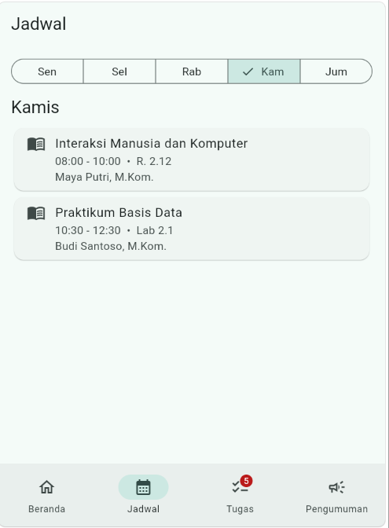
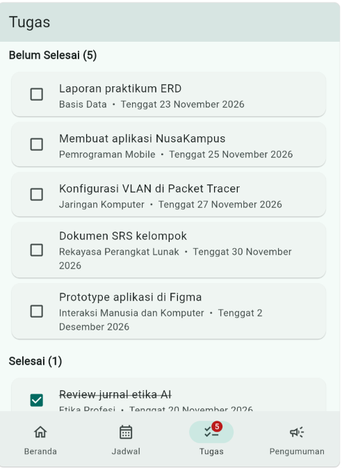
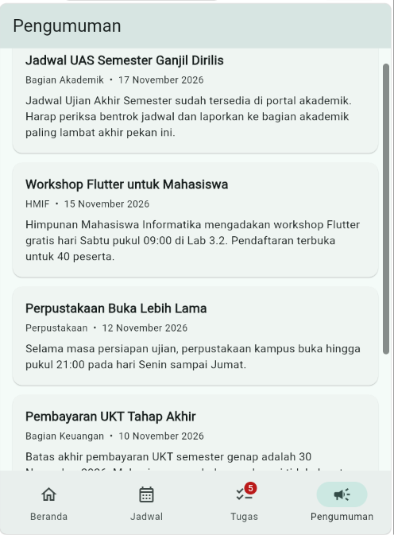
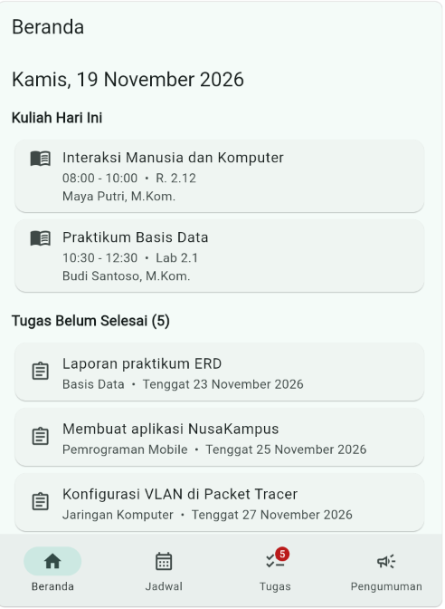
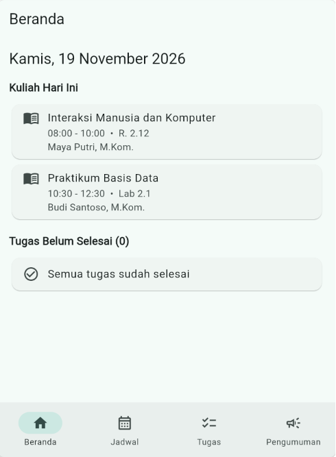
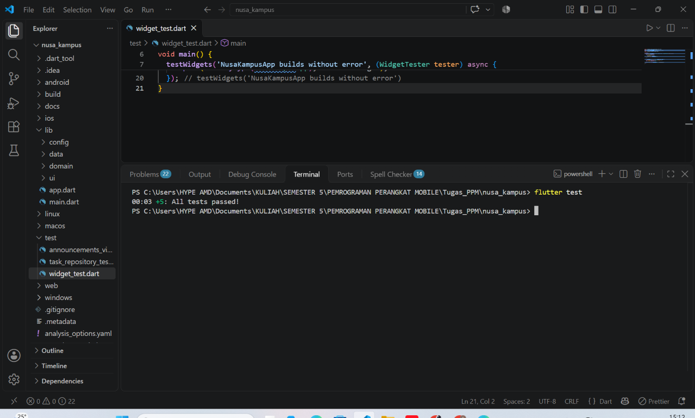

# NusaKampus

Aplikasi kampus sederhana (Flutter) untuk **Tugas Sesi 07 – Membangun Aplikasi Berskala Besar**.
Menerapkan arsitektur berlapis **View → ViewModel → Repository → Service** sesuai panduan resmi Flutter,
dengan `provider` untuk dependency injection.


Nama : Ari Rizal Zalaludin,
Nim : 20240040042

## Fitur
- **Beranda** – kuliah hari ini + tugas belum selesai (gabungan `ScheduleRepository` & `TaskRepository`).
- **Jadwal** – jadwal per hari (Senin–Jumat) memakai `SegmentedButton`.
- **Tugas** – `CheckboxListTile`; tugas yang dicentang pindah ke bagian *Selesai*. Badge tab Tugas menampilkan jumlah tugas belum selesai.
- **Pengumuman** – fitur buatan sendiri, daftar pengumuman dari `AnnouncementRepository`.

## Struktur Folder
```
lib/
├── main.dart
├── app.dart
├── config/dependencies.dart        # MultiProvider (service + repository)
├── domain/models/                  # Course, Task (copyWith), Announcement
├── data/
│   ├── services/campus_service.dart        # data contoh + Future.delayed
│   └── repositories/                       # schedule, task (ChangeNotifier), announcement
└── ui/
    ├── core/                       # BaseViewModel, AsyncBody, formatter, widget bersama
    ├── shell/app_shell.dart        # NavigationBar + badge
    └── home/ schedule/ tasks/ announcements/   # *_view_model.dart + *_screen.dart
test/
├── announcements_view_model_test.dart
└── task_repository_test.dart
```

## Cara Menjalankan
```bash
flutter pub get
flutter run
flutter test
```

## Screenshot

| Beranda | Jadwal |
|---|---|
|  |  |

| Tugas | Pengumuman |
|---|---|
|  |  |

### Beranda sebelum & sesudah tugas dicentang

| Sebelum | Sesudah |
|---|---|
|  |  |

### Hasil `flutter test`


